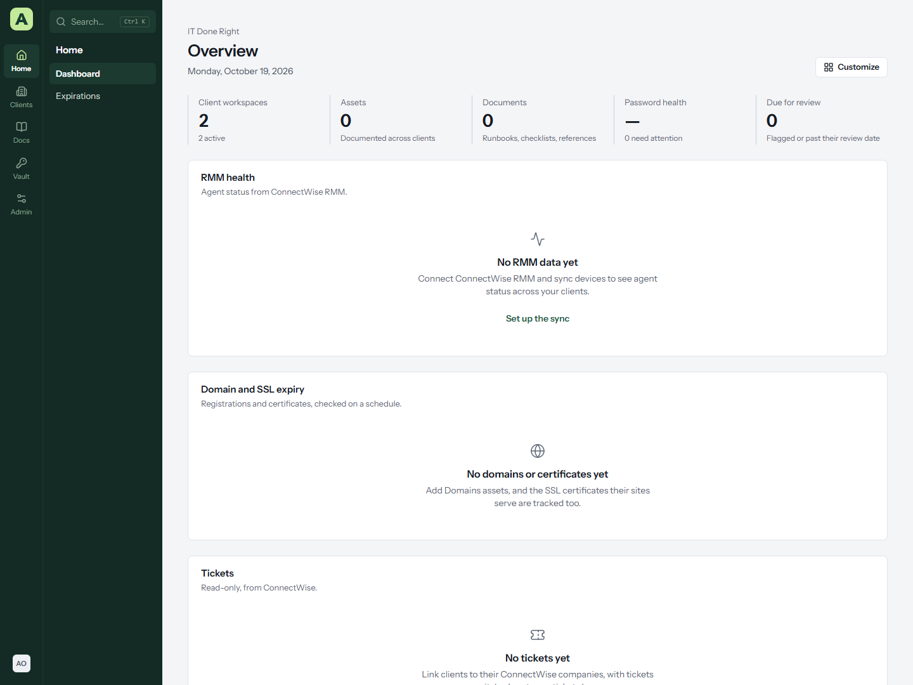
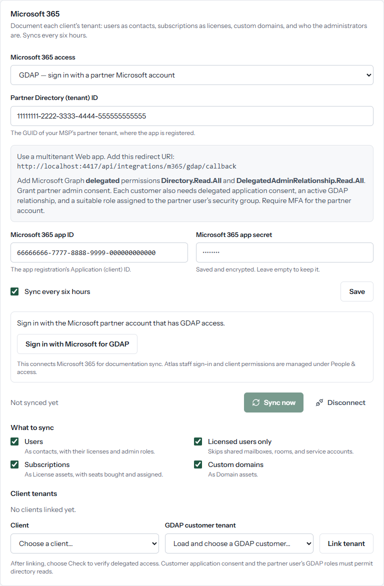

# Microsoft 365 with GDAP

Under **Administration → Import & export → Microsoft 365**, choose **GDAP — sign in with a partner Microsoft account**. This connects a partner account for customer documentation sync. Atlas staff authentication remains under **People & access → Microsoft sign-in**, with existing account linking, MFA, and client permissions.

## Microsoft setup

1. Register a **multitenant** app in your MSP's partner Entra tenant, supporting accounts in any organizational directory.
2. Add a **Web** redirect URI: https://your-atlas-host/api/integrations/m365/gdap/callback, replacing https://your-atlas-host with Atlas's public HTTPS origin. Atlas displays the complete address in the GDAP settings. Local HTTP is for loopback development only.
3. Create a client secret. Use its **Value**, not its Secret ID.
4. Add Microsoft Graph **delegated** permissions **Directory.Read.All** (the existing directory documentation sync) and **DelegatedAdminRelationship.Read.All** (relationship discovery). Grant administrator consent in the partner tenant. Atlas also requests OpenID Connect identity scopes and offline_access for background sync.
5. Use a partner account protected by MFA/Conditional Access. An active customer-approved GDAP relationship must assign that user suitable directory read roles through a partner security group. Discovering a relationship does not prove the user has access; the customer token exchange and Graph calls enforce the actual assignment.
6. Grant the app the required **delegated application consent in each customer tenant**. GDAP does not automatically supply application consent. A customer's administrator can grant consent, or a separately authorized Partner Center consent workflow can do so. Atlas does not create GDAP relationships, change roles, or grant consent for customers.

## Connect and map customers

Save the partner Directory (tenant) ID, app ID, and app secret. Choose **Sign in with Microsoft for GDAP** and use the partner account. After Microsoft returns, choose **Load GDAP customers**, then select an Atlas client and its customer tenant. Choose **Link tenant**, then **Check**. A successful check confirms customer-specific delegated Graph access. Choose **Sync now**, or keep **Sync every six hours** enabled.

Only active, unexpired GDAP relationships are offered. Each customer is explicitly mapped to an existing Atlas client; discovery does not provision clients or users and never assigns Atlas permissions. GDAP uses customer tenant GUIDs. Domain-based links made in application mode should be relinked using the discovered customer ID.

The existing **Application consent in each customer tenant** option remains available for installations using application permissions. GDAP mode never falls back to application credentials when delegated access fails.

## Sessions, tokens, and recovery

The partner connection is organization-wide for authorized Atlas administrators and scheduled sync. It does not give every Atlas technician the connected partner user's Microsoft session. Scheduled sync retains its existing Atlas administrator ownership and stops when that Atlas account is disabled or loses its administrator role.

Sign-in requires an active Atlas browser session, recent authentication, and CSRF validation. Microsoft returns through a ten-minute, one-use flow bound to that initiating session and a separate HttpOnly/SameSite=Lax cookie. Atlas validates PKCE, nonce, the partner tenant, issuer, audience, expiry, and Microsoft's RS256 signature before accepting the account. Server restarts expire unfinished sign-ins. Multi-instance deployments need sticky routing for the pending flow.

Refresh tokens are encrypted with Atlas's master key and organization-specific associated data, excluded from browser settings responses, renewed on use, and included in master-key rewrapping. Token refreshes are serialized per organization. Changing the app, partner tenant, mode, or secret clears the delegated connection. Disconnecting the partner account removes its stored refresh token and pending flows. To revoke the Microsoft grant itself, revoke it in Entra as well.

If Microsoft revokes the grant or requires a fresh MFA/Conditional Access interaction, choose **Reconnect partner account**. If a customer check fails, verify the active GDAP relationship, the partner user's group membership and assigned roles, and the customer's app consent. Atlas surfaces a failed check rather than silently using application permissions.

Failed Graph reads display recognized Microsoft error codes, fixed explanations, and a validated Microsoft request ID when available. Customer checks save the diagnostic in the tenant's status. Raw upstream messages and authentication challenges are not displayed or saved in that diagnostic. Unknown codes or non-JSON errors retain the HTTP status and endpoint without an invented explanation. These details describe the failed request; they do not establish that customer consent or GDAP assignments are correct.

## Screenshots

Synthetic data only:

## References

- [Microsoft GDAP and the secure application model](https://learn.microsoft.com/en-us/partner-center/developer/gdap-and-secure-application-model)
- [Microsoft Graph GDAP relationships](https://learn.microsoft.com/en-us/graph/api/tenantrelationship-list-delegatedadminrelationships?view=graph-rest-1.0)
- [Microsoft authorization code flow with PKCE](https://learn.microsoft.com/en-us/entra/identity-platform/v2-oauth2-auth-code-flow)

Automated tests use a local temporary PostgreSQL database and a mocked Microsoft service issuing real RS256 signatures. Live Microsoft sign-in requires your app registration and tenant consent and has to be verified with your partner account.
